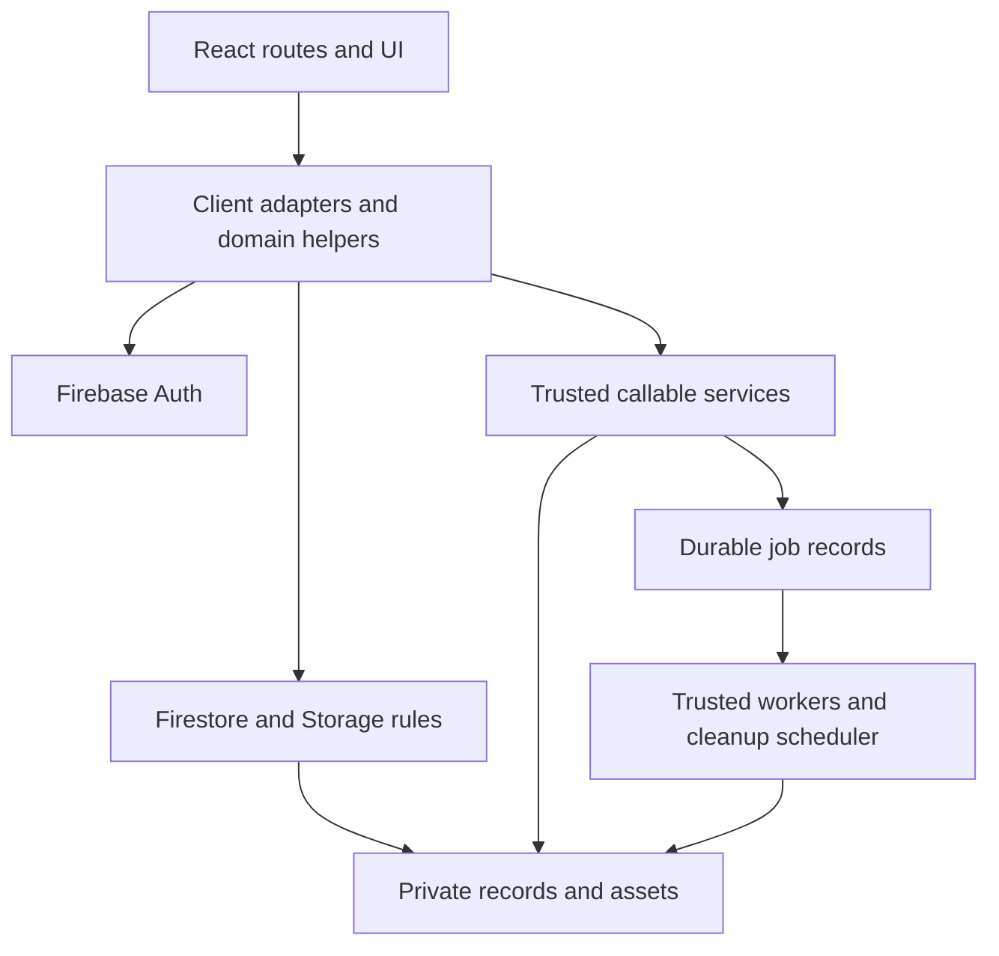

# System architecture

Current code structure, 8 November 2026. This describes the existing application, not a replatform or production-readiness claim.

## Frontend boundaries

`app/src/main.tsx` creates the React root and browser router. `App.tsx` declares `/`, `/explore`, `/saved`, `/messages`, `/connections`, `/notifications`, `/listings`, `/profile`, `/admin` and `/help`. Landing, admin and help pages use React components. The existing Explore interface is mounted by `pages/ExplorePage.tsx` through `lib/exploreEngine.js` and its declaration file. That imperative renderer remains technical debt; it was not silently rewritten during repository cleanup.

`components/` contains reusable/authentication and landing components. `hooks/` contains referenced stateful integrations. `store/` owns shared UI state. `lib/` contains domain contracts and Firebase client adapters. Tests beside domain modules verify their public contracts. Keep feature rules in helpers/adapters rather than duplicating them in page markup.

`nestmateBackend.ts` handles current client-side transactions and subscriptions. `discoveryGateway.ts` calls trusted allowlisted discovery endpoints. `accountJobs.ts` handles export and broadcast callables. `support.ts` stores narrow support requests. Pure helpers such as `applicationState.ts`, `relationshipState.ts`, `userIntent.ts`, `listingTruth.ts` and `matching.ts` define shared product behavior.

## Trusted services and authorization

`app/functions/index.js` wires Firebase callable/event/scheduler exports. `discoveryGateway.js` returns allowlisted physical/member projections and pair-scoped context. `accountJobs.js` owns export preparation, private download metadata, durable broadcast pages and export expiry. `accountDeletionService.js` and `accountDeletion.js` implement the staged deletion lifecycle behind a disabled availability gate.

Firestore and Storage rules enforce authorization at the data boundary, including negative access, account restrictions and consent. Client checks are useful feedback but do not replace these rules. Private source profiles/listings are not public discovery endpoints. Staff capabilities come from the trusted registry, not editable profile fields.

Functions use generated `sharedMatching.js` and `sharedUserIntent.js`. `scripts/build-functions-shared.cjs --check` verifies drift from client domain source. Update generated modules through that script.

## Domain boundaries

- Person consent, listing-specific communication permission and applications are separate records.
- Initial room messaging requires poster acceptance. Accepted permission may reuse the pair conversation.
- Selection/shortlisting never reserves or fills inventory. The cumulative request allowance has no invented monthly reset.
- Chat sends use stable retry identifiers; private attachments and per-member read state are persisted.
- Export and broadcast jobs have trusted ownership, progress and retry state. Local HTTP/worker acceptance does not prove deployed trigger delivery.
- Account deletion stays disabled pending collection/bucket coverage and lifecycle acceptance; the chosen policy retains shared history for peers while removing account identity.

## Repository boundaries

The root package contains integration tools. `app/package.json` contains browser dependencies and frontend tools. `app/functions/package.json` contains trusted runtime dependencies. There is no dependency from the application back to the root package. Production images belong in `app/public/`; temporary screenshots and reports belong in ignored output locations. Do not add one-off source-rewriting or production-reset scripts to the maintained tool directory.

See [database boundaries](DATABASE_SCHEMA.md), [testing](../testing/README.md), and [current acceptance](../workflow-correction/ACCEPTANCE_STATUS.md).
