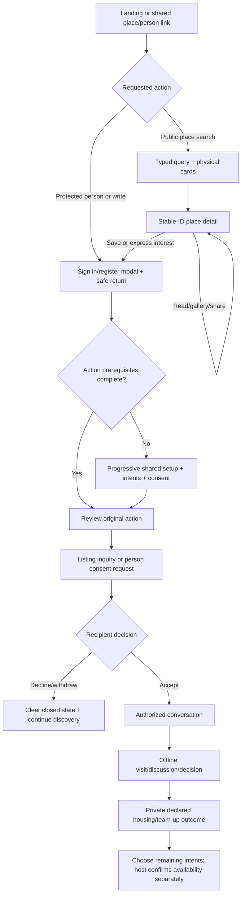

# Complete user experience flow

**Phase 1 — proposed product design, not implemented behavior.** Prepared 5 November 2026. Deliverables are confined to docs/master-product-blueprint/. The approved user-facing visual design is a constraint. Existing source, UI, Firebase schemas/rules/functions, dependencies and data are unchanged. “Target” describes the reviewed-to-be product contract; numeric, retention and rollout choices marked policy approval required are proposals, not existing promises.

## First interaction and alternate entry paths

A shared detail link can bypass landing and query screens. Signing in never auto-sends an abandoned request, accepts a relationship or publishes a draft. A returning authenticated member can resume an authorized Saved record, conversation, draft or pending review by stable ID. Auth recovery returns to the same safe context without exposing another account’s draft.

## Complete transition ledger

Each transition includes origin, visible inputs/actions, purpose, operation, destination, required data, authorization, persistence, next action, recovery and refresh/back behavior. The referenced page specification supplies its complete required content. No target acceptance statement below is an executed test.

### T01 — Choose a search

**Actor / current location:** Visitor/member; P01.

**What the user sees and can do:** Choose a search using Location/city, category, budget and move-in; supported options only.

**Purpose and prerequisite:** Public browsing needs no account.

**Backend/business operation:** Serialize typed filters into the canonical discovery URL and execute supported query.

**Destination/result:** P04/P05/P06/P07; query response with opaque cursor and total-scope label.

**Authoritative persistence:** No durable user write; URL/local navigation context only.

**Next available action:** Refine, open a card or authenticate for a protected action.

**Failure/cancellation:** Reject unsupported city/filter visibly; never silently fall back to Bengaluru. No irreversible consequence follows from merely opening the view; cancellation before commit creates no successful business event. After acknowledgement, reversal uses its explicit domain command.

**Refresh/return:** The same query is restored from URL; Back returns to the landing draft.

**Completion criterion:** The acknowledged result matches the authoritative read, the authorized next action is reachable, and every affected participant sees the corresponding state under CROSS_PAGE_CONSISTENCY_MAP.md.

### T02 — Open a stable entity

**Actor / current location:** Visitor/member; P04/P05/P06/P07/P10/P11/P13.

**What the user sees and can do:** Open a stable entity using entityType + persisted ID + safe origin context.

**Purpose and prerequisite:** Authorize public listing/member/publisher/relationship scope before returning fields.

**Backend/business operation:** Read entity-by-ID projection and related authorized references.

**Destination/result:** P08/P09/P12/P22 according to entity type.

**Authoritative persistence:** No business-state write; optional privacy-safe analytics is separate.

**Next available action:** Inspect, save, contact, manage or go back.

**Failure/cancellation:** Distinguish not-found/unavailable/permission/network; do not infer missing from an absent feed card. No irreversible consequence follows from merely opening the view; cancellation before commit creates no successful business event. After acknowledgement, reversal uses its explicit domain command.

**Refresh/return:** Deep link re-fetches by ID; preserve query/filter/scroll return context.

**Completion criterion:** The acknowledged result matches the authoritative read, the authorized next action is reachable, and every affected participant sees the corresponding state under CROSS_PAGE_CONSISTENCY_MAP.md.

### T03 — Authenticate and resume

**Actor / current location:** Visitor; P02.

**What the user sees and can do:** Authenticate and resume using Provider/email credentials and allowlisted return descriptor.

**Purpose and prerequisite:** Supported Auth provider; validate return path.

**Backend/business operation:** Authenticate; hydrate own account; route to missing prerequisites or original destination.

**Destination/result:** P03 or original authorized view.

**Authoritative persistence:** Auth identity/session; private/public initial account writes only on actual registration.

**Next available action:** Review the original intended action; no automatic sending/approval.

**Failure/cancellation:** Inline accessible error; retain nonsensitive draft; close returns to origin. No irreversible consequence follows from merely opening the view; cancellation before commit creates no successful business event. After acknowledgement, reversal uses its explicit domain command.

**Refresh/return:** Session restoration precedes private rendering; retry return context is safe and owned.

**Completion criterion:** The acknowledged result matches the authoritative read, the authorized next action is reachable, and every affected participant sees the corresponding state under CROSS_PAGE_CONSISTENCY_MAP.md.

### T04 — Finish shared setup

**Actor / current location:** Active incomplete member; P03.

**What the user sees and can do:** Finish shared setup using Name/city/locality, concurrent goals and explicit discoverability decision.

**Purpose and prerequisite:** Self only; meaningful essentials validated server-side.

**Backend/business operation:** Commit profile/setup version and requested public projection consent.

**Destination/result:** Original context or chosen discovery section.

**Authoritative persistence:** Private profile + disclosure/intent version; no staff/trust/occupancy mutation.

**Next available action:** Complete optional preferences, create a draft or request communication.

**Failure/cancellation:** Keep unsaved choices and field errors; optional questions may be skipped as unknown. No irreversible consequence follows from merely opening the view; cancellation before commit creates no successful business event. After acknowledgement, reversal uses its explicit domain command.

**Refresh/return:** Resume saved setup progress; never publish a card from an abandoned draft.

**Completion criterion:** The acknowledged result matches the authoritative read, the authorized next action is reachable, and every affected participant sees the corresponding state under CROSS_PAGE_CONSISTENCY_MAP.md.

### T05 — Save/remove a bookmark

**Actor / current location:** Active signed-in member; P01/P04/P05/P06/P07/P08/P09/P10.

**What the user sees and can do:** Save/remove a bookmark using Typed entity reference and desired saved boolean.

**Purpose and prerequisite:** Self write; current entity access checked without requiring public discoverability for an existing authorized reference.

**Backend/business operation:** Idempotently set desired bookmark state; return saved version.

**Destination/result:** Same view and P10.

**Authoritative persistence:** Own bookmark record only.

**Next available action:** Open Saved or continue browsing.

**Failure/cancellation:** Revert pending affordance and retain prior confirmed state; do not announce success on failure. No irreversible consequence follows from merely opening the view; cancellation before commit creates no successful business event. After acknowledgement, reversal uses its explicit domain command.

**Refresh/return:** Read authoritative typed bookmarks and hydrate IDs independently.

**Completion criterion:** The acknowledged result matches the authoritative read, the authorized next action is reachable, and every affected participant sees the corresponding state under CROSS_PAGE_CONSISTENCY_MAP.md.

### T06 — Submit listing interest

**Actor / current location:** Active complete member; P08.

**What the user sees and can do:** Submit listing interest using listingId, listing version, recipient publisher UID, required answer snapshot, optional introduction.

**Purpose and prerequisite:** Published/available listing; not self; no block; valid answers; quota only if a new pair request is created.

**Backend/business operation:** Create listing Inquiry/Application and attach or create pair ConsentRequest atomically/idempotently.

**Destination/result:** P08 confirmation; P11 and recipient P16/P13.

**Authoritative persistence:** Application + optional new request/quota event + durable notification outbox.

**Next available action:** Withdraw interest; await explicit consent, or open existing accepted chat.

**Failure/cancellation:** Listing changed/filled → review current data; preserve answers but do not charge or submit stale interest. No irreversible consequence follows from merely opening the view; cancellation before commit creates no successful business event. After acknowledgement, reversal uses its explicit domain command.

**Refresh/return:** Show the authoritative application and pair state, not a repeated submission form.

**Completion criterion:** The acknowledged result matches the authoritative read, the authorized next action is reachable, and every affected participant sees the corresponding state under CROSS_PAGE_CONSISTENCY_MAP.md.

### T07 — Request person connection

**Actor / current location:** Active complete member; P09/P06.

**What the user sees and can do:** Request person connection using Target UID, optional contextual note, request intent and idempotency key.

**Purpose and prerequisite:** Authorized profile; not self; no direction blocked; recipient-open policy; allowance available.

**Backend/business operation:** Create one versioned pair request and quota consumption with recipient event.

**Destination/result:** P11 Sent and corresponding person/card actions.

**Authoritative persistence:** Pair request + usage event + outbox; no application or listing occupancy change.

**Next available action:** Withdraw while pending or await decision.

**Failure/cancellation:** Reverse pending request becomes Incoming action; duplicate returns same result; exhaustion shows real renewal/recovery. No irreversible consequence follows from merely opening the view; cancellation before commit creates no successful business event. After acknowledgement, reversal uses its explicit domain command.

**Refresh/return:** Pending/accepted/closed state is read by pair UID, not local optimistic flag.

**Completion criterion:** The acknowledged result matches the authoritative read, the authorized next action is reachable, and every affected participant sees the corresponding state under CROSS_PAGE_CONSISTENCY_MAP.md.

### T08 — Accept communication

**Actor / current location:** Recipient; P11/P13/P16/P09.

**What the user sees and can do:** Accept communication using Request ID + expected version.

**Purpose and prerequisite:** Recipient only; current pending state; both accounts eligible; no block.

**Backend/business operation:** Transition pending → accepted and update derived pair authorization in one trusted transaction.

**Destination/result:** Accepted actions + optional open P12.

**Authoritative persistence:** Consent decision + authorization mirror + notification event.

**Next available action:** Message or continue separate applicant review.

**Failure/cancellation:** Concurrent withdraw/block wins by version; refresh actual state, never overwrite it with acceptance. No irreversible consequence follows from merely opening the view; cancellation before commit creates no successful business event. After acknowledgement, reversal uses its explicit domain command.

**Refresh/return:** Both users see accepted state; no listing is filled or applicant automatically selected.

**Completion criterion:** The acknowledged result matches the authoritative read, the authorized next action is reachable, and every affected participant sees the corresponding state under CROSS_PAGE_CONSISTENCY_MAP.md.

### T09 — Decline communication

**Actor / current location:** Recipient; P11/P13/P09.

**What the user sees and can do:** Decline communication using Request ID + expected version; optional private reason.

**Purpose and prerequisite:** Recipient owns pending decision.

**Backend/business operation:** Transition pending → declined; close this request and cancel associated consent access.

**Destination/result:** Closed state; sender sees generic decline without private reason.

**Authoritative persistence:** Request decision + minimal recipient/sender event.

**Next available action:** Recipient may explicitly reopen/initiate later; sender cannot repeatedly reopen a declined request.

**Failure/cancellation:** Conflict returns current status; never fake a local decline. No irreversible consequence follows from merely opening the view; cancellation before commit creates no successful business event. After acknowledgement, reversal uses its explicit domain command.

**Refresh/return:** Closed state persists across cards/profiles/inbox; unrelated existing outcomes remain unchanged.

**Completion criterion:** The acknowledged result matches the authoritative read, the authorized next action is reachable, and every affected participant sees the corresponding state under CROSS_PAGE_CONSISTENCY_MAP.md.

### T10 — Withdraw a pending request or inquiry

**Actor / current location:** Sender/applicant; P11/P08.

**What the user sees and can do:** Withdraw a pending request or inquiry using Request/application ID + expected version; explicitly chosen scope.

**Purpose and prerequisite:** Own pending request or active application; no withdrawal of another actor’s decision.

**Backend/business operation:** Withdraw chosen entity; if pair consent is shared by other contexts, do not silently revoke that accepted relationship.

**Destination/result:** Closed inquiry/request state at origin and counterpart lists.

**Authoritative persistence:** Scoped withdrawal record; no automatic quota refund.

**Next available action:** Continue browsing or start a separately eligible action.

**Failure/cancellation:** Conflict explains accepted/closed state and offers relevant next action. No irreversible consequence follows from merely opening the view; cancellation before commit creates no successful business event. After acknowledgement, reversal uses its explicit domain command.

**Refresh/return:** Scope and final status remain visible; refresh cannot restore a withdrawn action.

**Completion criterion:** The acknowledged result matches the authoritative read, the authorized next action is reachable, and every affected participant sees the corresponding state under CROSS_PAGE_CONSISTENCY_MAP.md.

### T11 — Open an authorized conversation

**Actor / current location:** Accepted active participant; P09/P11/P16.

**What the user sees and can do:** Open an authorized conversation using Pair UIDs, optional authorized listing context.

**Purpose and prerequisite:** Live accepted consent; no blocks or restricted participant.

**Backend/business operation:** Resolve deterministic pair conversation; reuse legacy room through reviewed compatibility mapping.

**Destination/result:** P12 with stable conversationId.

**Authoritative persistence:** Create/reuse room and optional context link, not a second consent record.

**Next available action:** Read history, send text or request explicit contact disclosure.

**Failure/cancellation:** Unauthorized/stale consent → explain restriction; do not create a phantom local chat. No irreversible consequence follows from merely opening the view; cancellation before commit creates no successful business event. After acknowledgement, reversal uses its explicit domain command.

**Refresh/return:** Direct room URL reauthorizes; history is loaded by cursor, not feed tuples.

**Completion criterion:** The acknowledged result matches the authoritative read, the authorized next action is reachable, and every affected participant sees the corresponding state under CROSS_PAGE_CONSISTENCY_MAP.md.

### T12 — Send text

**Actor / current location:** Accepted active participant; P12.

**What the user sees and can do:** Send text using conversationId, clientMessageId, nonempty bounded text.

**Purpose and prerequisite:** Live send authorization on commit, not just when composer opened.

**Backend/business operation:** Persist message plus room summary and recipient delivery/read metadata idempotently.

**Destination/result:** P12 acknowledged message; other participant live stream/P13 if preference permits.

**Authoritative persistence:** Message + summary + unread/read cursor state + notification event.

**Next available action:** Continue conversation or record a later housing decision.

**Failure/cancellation:** Pending/failed draft remains identified; retry same client ID; no success before acknowledgement. No irreversible consequence follows from merely opening the view; cancellation before commit creates no successful business event. After acknowledgement, reversal uses its explicit domain command.

**Refresh/return:** Confirmed messages survive reload; unsent draft is clearly local and account-scoped.

**Completion criterion:** The acknowledged result matches the authoritative read, the authorized next action is reachable, and every affected participant sees the corresponding state under CROSS_PAGE_CONSISTENCY_MAP.md.

### T13 — Send an attachment

**Actor / current location:** Accepted active participant; P12.

**What the user sees and can do:** Send an attachment using Validated supported image, size/type, upload ID and conversation scope.

**Purpose and prerequisite:** Same live consent; supported bytes/MIME/size; no executable format.

**Backend/business operation:** Upload to private chat Storage staging; validate; commit message reference only after success.

**Destination/result:** P12 acknowledged image and safe preview.

**Authoritative persistence:** Authorized object + message reference; cleanup/retry job for abandoned staging.

**Next available action:** View or continue chat.

**Failure/cancellation:** Upload progress/cancel/retry; block during transfer prevents final send; no base64 document fallback. No irreversible consequence follows from merely opening the view; cancellation before commit creates no successful business event. After acknowledgement, reversal uses its explicit domain command.

**Refresh/return:** Committed reference is durable; resumable drafts have explicit expiry and no cross-account leakage.

**Completion criterion:** The acknowledged result matches the authoritative read, the authorized next action is reachable, and every affected participant sees the corresponding state under CROSS_PAGE_CONSISTENCY_MAP.md.

### T14 — Mark/read and return

**Actor / current location:** Authorized participant; P12/P13.

**What the user sees and can do:** Mark/read and return using Last visible message/event cursor and account identity.

**Purpose and prerequisite:** Self read state only.

**Backend/business operation:** Advance per-member read cursor monotonically; derive unread count from authoritative event/message state.

**Destination/result:** Inbox badge/filter and counterpart receipt only if disclosed by policy.

**Authoritative persistence:** Own read cursor; no arbitrary peer count edit.

**Next available action:** Open next unread conversation or return to prior context.

**Failure/cancellation:** Read-state failure may retry quietly but must not mark undelivered content read; offline state is explicit. No irreversible consequence follows from merely opening the view; cancellation before commit creates no successful business event. After acknowledgement, reversal uses its explicit domain command.

**Refresh/return:** Read position persists; late/old snapshots cannot restore stale counts.

**Completion criterion:** The acknowledged result matches the authoritative read, the authorized next action is reachable, and every affected participant sees the corresponding state under CROSS_PAGE_CONSISTENCY_MAP.md.

### T15 — Share external contact/address

**Actor / current location:** Accepted active participant; P12/P08 contextual flow.

**What the user sees and can do:** Share external contact/address using Specific contact field, intended peer, disclosure consent/version.

**Purpose and prerequisite:** Owner of the data explicitly opts in; acceptance alone is insufficient.

**Backend/business operation:** Create scoped disclosure grant or send explicit user-chosen content with retention warning.

**Destination/result:** P12 disclosed subset; no automatic public profile update.

**Authoritative persistence:** Private contact grant/audit reference; raw number not placed in public source docs.

**Next available action:** Withdraw future access; understand previously copied information cannot be recalled.

**Failure/cancellation:** No grant on failed consent/write; recipient sees unavailable rather than inferred number. No irreversible consequence follows from merely opening the view; cancellation before commit creates no successful business event. After acknowledgement, reversal uses its explicit domain command.

**Refresh/return:** Only still-valid grants are re-fetched; revocation removes future in-app access.

**Completion criterion:** The acknowledged result matches the authoritative read, the authorized next action is reachable, and every affected participant sees the corresponding state under CROSS_PAGE_CONSISTENCY_MAP.md.

### T16 — Block/unblock

**Actor / current location:** Either participant / owner of directional block; P09/P12/P20.

**What the user sees and can do:** Block/unblock using Target UID; explicit block or remove-own-block action.

**Purpose and prerequisite:** Own block decision; cannot remove the peer’s block.

**Backend/business operation:** Block transaction restricts pair authorization across all contexts; unblock removes only own record and does not restore accepted consent.

**Destination/result:** Restricted history/composer and own block list.

**Authoritative persistence:** Directional block + request/authorization derived state + private audit; no block notification to peer.

**Next available action:** Report/support; after all blocks removed, obtain fresh consent if recipient permits.

**Failure/cancellation:** Idempotent action; partial deletion of mirrors is prevented; do not leak who blocked whom. No irreversible consequence follows from merely opening the view; cancellation before commit creates no successful business event. After acknowledgement, reversal uses its explicit domain command.

**Refresh/return:** Restriction survives reload and applies to existing rooms, new IDs and all listing contexts.

**Completion criterion:** The acknowledged result matches the authoritative read, the authorized next action is reachable, and every affected participant sees the corresponding state under CROSS_PAGE_CONSISTENCY_MAP.md.

### T17 — Report a safety concern

**Actor / current location:** Signed-in member; P08/P09/P12.

**What the user sees and can do:** Report a safety concern using Typed target ID, reason, bounded explanation and consented evidence reference.

**Purpose and prerequisite:** Actor bound to Auth; valid target; rate/abuse policy.

**Backend/business operation:** Create report/case reference and staff queue event.

**Destination/result:** Acknowledged case with safety options; P22 scoped queue.

**Authoritative persistence:** Private moderation case and minimal event; no automatic guilt/tenancy action.

**Next available action:** Block if wanted, preserve allowed evidence, seek support.

**Failure/cancellation:** Retry same report ID; never tell the user a failed report reached staff. No irreversible consequence follows from merely opening the view; cancellation before commit creates no successful business event. After acknowledgement, reversal uses its explicit domain command.

**Refresh/return:** Own acknowledgement/reference persists without exposing private staff notes or other reporters.

**Completion criterion:** The acknowledged result matches the authoritative read, the authorized next action is reachable, and every affected participant sees the corresponding state under CROSS_PAGE_CONSISTENCY_MAP.md.

### T18 — Create/resume listing draft

**Actor / current location:** Authorized publisher; P14/P15.

**What the user sees and can do:** Create/resume listing draft using Typed listing kind/unit, draft ID/version and explicit authorization/residence declarations.

**Purpose and prerequisite:** Self/assigned publisher capability and complete shared profile; no false legal ownership inference.

**Backend/business operation:** Create/resume owned private draft before listing-scoped uploads.

**Destination/result:** P15 same step/draft.

**Authoritative persistence:** Private listing draft and staged objects, not public availability.

**Next available action:** Save draft, complete remaining fields, preview or submit.

**Failure/cancellation:** Stage-specific validation; failed upload retains draft ID and selected source; no active publication. No irreversible consequence follows from merely opening the view; cancellation before commit creates no successful business event. After acknowledgement, reversal uses its explicit domain command.

**Refresh/return:** Owned draft can resume by ID; Close warns about unsaved changes.

**Completion criterion:** The acknowledged result matches the authoritative read, the authorized next action is reachable, and every affected participant sees the corresponding state under CROSS_PAGE_CONSISTENCY_MAP.md.

### T19 — Submit property for review

**Actor / current location:** Authorized publisher; P15.

**What the user sees and can do:** Submit property for review using Complete draft/version, photos, actual price/unit/capacity, questions, consent and identity prerequisite status.

**Purpose and prerequisite:** Configured publication prerequisites; declared data passes shared schema.

**Backend/business operation:** Submit immutable review version; enqueue staff review; keep previous approved version policy explicit for edits.

**Destination/result:** P14 pending/changes requested; P22 review queue.

**Authoritative persistence:** Review submission/version + outbox; public projection remains absent or prior approved version only.

**Next available action:** Wait, withdraw draft or respond to a review request.

**Failure/cancellation:** No upload/validation/network failure can report Published; retries use same submission ID. No irreversible consequence follows from merely opening the view; cancellation before commit creates no successful business event. After acknowledgement, reversal uses its explicit domain command.

**Refresh/return:** Exact submitted version/status and staff notes remain visible.

**Completion criterion:** The acknowledged result matches the authoritative read, the authorized next action is reachable, and every affected participant sees the corresponding state under CROSS_PAGE_CONSISTENCY_MAP.md.

### T20 — Approve/request changes on property

**Actor / current location:** Authorized content reviewer; P22.

**What the user sees and can do:** Approve/request changes on property using Submission ID/version, decision and reason.

**Purpose and prerequisite:** Explicit property-review capability; publisher eligibility/identity prerequisites checked.

**Backend/business operation:** Approve exact content version or request changes; derive public availability from all independent gates.

**Destination/result:** Publisher P14/P15; eligible public detail/feed.

**Authoritative persistence:** Review decision + published projection/outbox atomically or a tracked job.

**Next available action:** Publisher can advertise/reconfirm; rejected version can be corrected/resubmitted.

**Failure/cancellation:** Conflict refreshes reviewed version; no approval of a newer unseen draft. No irreversible consequence follows from merely opening the view; cancellation before commit creates no successful business event. After acknowledgement, reversal uses its explicit domain command.

**Refresh/return:** Staff/publisher/public see the same effective version and clear status.

**Completion criterion:** The acknowledged result matches the authoritative read, the authorized next action is reachable, and every affected participant sees the corresponding state under CROSS_PAGE_CONSISTENCY_MAP.md.

### T21 — Edit published property

**Actor / current location:** Authorized publisher; P14/P15.

**What the user sees and can do:** Edit published property using Listing ID/version and field-level diff.

**Purpose and prerequisite:** Owner/assigned publisher; current account active.

**Backend/business operation:** Save new draft; material price/location/capacity/residence/trust-sensitive edits require configured re-review. Safe editorial changes follow an explicit allowlist.

**Destination/result:** P15/P14 with prior published versus pending version clearly separated.

**Authoritative persistence:** New draft/review version; effective public record changes only after required approval.

**Next available action:** Submit review, discard draft or retain prior approved record as allowed.

**Failure/cancellation:** Stale edit returns conflict and comparison; never overwrite concurrent availability silently. No irreversible consequence follows from merely opening the view; cancellation before commit creates no successful business event. After acknowledgement, reversal uses its explicit domain command.

**Refresh/return:** Discard affects draft only; all pages resolve effective published version.

**Completion criterion:** The acknowledged result matches the authoritative read, the authorized next action is reachable, and every affected participant sees the corresponding state under CROSS_PAGE_CONSISTENCY_MAP.md.

### T22 — Pause/reconfirm/fill/reopen a listing

**Actor / current location:** Authorized publisher; P14/P08 management.

**What the user sees and can do:** Pause/reconfirm/fill/reopen a listing using Listing ID/version, desired availability and explicit confirmation.

**Purpose and prerequisite:** Current publishability/account checks; reopen requires valid approval/trust/freshness.

**Backend/business operation:** Change availability independently from publication review. Filled is an explicit host confirmation of zero availability.

**Destination/result:** P14, public listing tombstone, Saved/context cards and host eligibility.

**Authoritative persistence:** Availability/version + public projection/outbox; no automatic tenant assignment.

**Next available action:** Correct declaration, reopen if eligible or complete optional outcome follow-up.

**Failure/cancellation:** Conflict preserves latest value; no silent active fallback for pending/rejected accounts. No irreversible consequence follows from merely opening the view; cancellation before commit creates no successful business event. After acknowledgement, reversal uses its explicit domain command.

**Refresh/return:** True state persists; filled/expired leave new discovery but authorized history remains understandable.

**Completion criterion:** The acknowledged result matches the authoritative read, the authorized next action is reachable, and every affected participant sees the corresponding state under CROSS_PAGE_CONSISTENCY_MAP.md.

### T23 — Review/shortlist/decline/select an applicant

**Actor / current location:** Listing publisher; P16/P17.

**What the user sees and can do:** Review/shortlist/decline/select an applicant using Application ID/version, stage and optional private note.

**Purpose and prerequisite:** Listing ownership; stage transition allowed; applicant disclosure scope valid.

**Backend/business operation:** Commit owner-scoped application stage; selected expresses intended housing decision only. Communication acceptance is a separate labelled command.

**Destination/result:** Applicant list/detail and appropriate applicant status notice.

**Authoritative persistence:** Application stage/note and event; no implicit connection acceptance or listing fill.

**Next available action:** Explicit chat consent, mutual housing acknowledgement or host availability confirmation.

**Failure/cancellation:** Await commit; current stage on conflict; cannot decline an accepted relationship by pretending it is applicant tracking. No irreversible consequence follows from merely opening the view; cancellation before commit creates no successful business event. After acknowledgement, reversal uses its explicit domain command.

**Refresh/return:** Stages reload from records, not APS/index-local state.

**Completion criterion:** The acknowledged result matches the authoritative read, the authorized next action is reachable, and every affected participant sees the corresponding state under CROSS_PAGE_CONSISTENCY_MAP.md.

### T24 — Declare housing/team-up outcome

**Actor / current location:** Involved member / publisher for availability; P20/P16/P12 follow-up.

**What the user sees and can do:** Declare housing/team-up outcome using Outcome type, contextual entity, source/self-report and remaining intent choices.

**Purpose and prerequisite:** Self declaration; mutual claim requires both acknowledgements; owner controls listing availability independently.

**Backend/business operation:** Record private outcome; explicitly update only chosen search intents/opt-in; prompt host separately if relevant.

**Destination/result:** Private outcome summary and optional next activity.

**Authoritative persistence:** Outcome declaration/version and consented aggregate event.

**Next available action:** Continue a remaining intent, pause discovery or return later; no booking/lease created.

**Failure/cancellation:** Member can correct a declaration; no automatic publication, quota or peer-state mutation on failed follow-up. No irreversible consequence follows from merely opening the view; cancellation before commit creates no successful business event. After acknowledgement, reversal uses its explicit domain command.

**Refresh/return:** Outcome remains labelled self-reported/mutual; others never receive fabricated occupancy proof.

**Completion criterion:** The acknowledged result matches the authoritative read, the authorized next action is reachable, and every affected participant sees the corresponding state under CROSS_PAGE_CONSISTENCY_MAP.md.

### T25 — Save/discard profile/preferences/avatar

**Actor / current location:** Account owner; P18.

**What the user sees and can do:** Save/discard profile/preferences/avatar using Versioned complete draft with preserved undisplayed fields and selected disclosure.

**Purpose and prerequisite:** Self; allowed editable fields; no staff/trust/status/grant changes.

**Backend/business operation:** Validate shared profile/preferences contract; stage avatar object; commit all explicit edits or discard without publishing them.

**Destination/result:** P18 overview and own public preview.

**Authoritative persistence:** Profile/private preferences/disclosure projection version; object reference only on commit.

**Next available action:** Return to intended marketplace action or adjust remaining preferences.

**Failure/cancellation:** Field errors preserve draft; upload failure does not erase prior avatar; conflict offers field comparison. No irreversible consequence follows from merely opening the view; cancellation before commit creates no successful business event. After acknowledgement, reversal uses its explicit domain command.

**Refresh/return:** Refresh shows confirmed saved state; discard preserves prior image and all undisplayed localities.

**Completion criterion:** The acknowledged result matches the authoritative read, the authorized next action is reachable, and every affected participant sees the corresponding state under CROSS_PAGE_CONSISTENCY_MAP.md.

### T26 — Submit/review/resubmit ID

**Actor / current location:** Owner / identity reviewer; P19/P22.

**What the user sees and can do:** Submit/review/resubmit ID using Private supported document, declared name/type, consent; reviewer sees submission ID/version.

**Purpose and prerequisite:** Owner self-submit; reviewer capability; evidence purpose/retention disclosed.

**Backend/business operation:** Stage private object; submit immutable evidence version; reviewer approves/rejects exact version with reason; mirror trust from decision.

**Destination/result:** P19 status/note; publisher prerequisites and staff queues.

**Authoritative persistence:** Versioned verification/evidence pointer/audit/trust mirrors; no Aadhaar certification or property auto-activation.

**Next available action:** Rejected owner corrects and submits new version; approved member sees precisely scoped badge.

**Failure/cancellation:** Reject unsupported/oversized/legacy active content; old review cannot overwrite new submission; cleanup has retry state. No irreversible consequence follows from merely opening the view; cancellation before commit creates no successful business event. After acknowledgement, reversal uses its explicit domain command.

**Refresh/return:** Version/history and actual decision remain; no bearer ID URL or fabricated Verified screen.

**Completion criterion:** The acknowledged result matches the authoritative read, the authorized next action is reachable, and every affected participant sees the corresponding state under CROSS_PAGE_CONSISTENCY_MAP.md.

### T27 — Change credentials/logout

**Actor / current location:** Account owner; P20.

**What the user sees and can do:** Change credentials/logout using Provider-appropriate reauthentication, new credentials or sign-out request.

**Purpose and prerequisite:** Auth owner; recent auth for sensitive change.

**Backend/business operation:** Use Auth service; clear/rekey session caches on sign-out/account switch.

**Destination/result:** Confirmation or original public context.

**Authoritative persistence:** Auth identity state; verified email change only after actual verification.

**Next available action:** Sign back in, recover access or return to the product.

**Failure/cancellation:** Provider-specific explanation; no false password or email success; preserve safe return context. No irreversible consequence follows from merely opening the view; cancellation before commit creates no successful business event. After acknowledgement, reversal uses its explicit domain command.

**Refresh/return:** No prior account draft/private state is shown after switch; session expires into safe resume flow.

**Completion criterion:** The acknowledged result matches the authoritative read, the authorized next action is reachable, and every affected participant sees the corresponding state under CROSS_PAGE_CONSISTENCY_MAP.md.

### T28 — Set privacy/notifications

**Actor / current location:** Account owner; P20.

**What the user sees and can do:** Set privacy/notifications using Specific supported setting and disclosure scope/version.

**Purpose and prerequisite:** Own enforceable preference; required security notices distinguished from optional marketing.

**Backend/business operation:** Persist setting; apply it to profile projection/notification delivery, not just a toggle.

**Destination/result:** P20 and all affected public/private surfaces.

**Authoritative persistence:** Preference/disclosure version + cache invalidation/job state if needed.

**Next available action:** Preview disclosure, revoke optional grants or retry propagation.

**Failure/cancellation:** Keep previous confirmed toggle on failure; explicitly unavailable features cannot pretend to save. No irreversible consequence follows from merely opening the view; cancellation before commit creates no successful business event. After acknowledgement, reversal uses its explicit domain command.

**Refresh/return:** Reload and a second authorized account observe the enforced setting.

**Completion criterion:** The acknowledged result matches the authoritative read, the authorized next action is reachable, and every affected participant sees the corresponding state under CROSS_PAGE_CONSISTENCY_MAP.md.

### T29 — Export/delete account

**Actor / current location:** Account owner; P20.

**What the user sees and can do:** Export/delete account using Recent auth, exact requested scope, explicit deletion confirmation and retention disclosure.

**Purpose and prerequisite:** Self only; preserve support/appeal/data rights for restricted accounts subject to reviewed policy.

**Backend/business operation:** Create tracked private export/deletion job; collect current IDs/fields/storage bucket; enforce approved retention and peer-history decisions.

**Destination/result:** Job status/secured download or deletion completion; logged out only after actual completion.

**Authoritative persistence:** Job manifest/progress/audit; applicable data objects; Auth identity at safe final stage.

**Next available action:** Retry/recover, download within disclosed expiry or receive truthful completion summary.

**Failure/cancellation:** Partial failures remain retryable; no false email/deletion; short-lived download access is owner-only. No irreversible consequence follows from merely opening the view; cancellation before commit creates no successful business event. After acknowledgement, reversal uses its explicit domain command.

**Refresh/return:** Owner can resume job safely; completed erasure cannot be reset by profile recreation.

**Completion criterion:** The acknowledged result matches the authoritative read, the authorized next action is reachable, and every affected participant sees the corresponding state under CROSS_PAGE_CONSISTENCY_MAP.md.

### T30 — Suspend/ban/reinstate an account

**Actor / current location:** Authorized moderator/admin; P22.

**What the user sees and can do:** Suspend/ban/reinstate an account using Target UID/version, allowed sanction, reason and review scope.

**Purpose and prerequisite:** Capability-scoped trusted staff; cannot self-reinstate or escalate membership.

**Backend/business operation:** Commit sanction and derive all publication/send restrictions; propagation is atomic or a tracked job with visible pending state.

**Destination/result:** Staff case, member restriction notice/support and affected discovery/relationships.

**Authoritative persistence:** Moderation decision + account/publication policy versions + event/audit.

**Next available action:** Member appeal; authorized reinstatement re-evaluates prerequisites instead of blindly reactivating every listing.

**Failure/cancellation:** Failed propagation is not completed sanction; stale target requires review; preserve private reasons appropriately. No irreversible consequence follows from merely opening the view; cancellation before commit creates no successful business event. After acknowledgement, reversal uses its explicit domain command.

**Refresh/return:** Every page/rules path enforces effective status, including existing chat rooms and shared links.

**Completion criterion:** The acknowledged result matches the authoritative read, the authorized next action is reachable, and every affected participant sees the corresponding state under CROSS_PAGE_CONSISTENCY_MAP.md.

### T31 — Resolve report/review staff work

**Actor / current location:** Authorized staff; P22.

**What the user sees and can do:** Resolve report/review staff work using Case/version, typed target, note, outcome and any required sanction.

**Purpose and prerequisite:** Least-privilege capability; evidence access logged.

**Backend/business operation:** Apply case outcome and required sanction atomically or through a visible applying→completed workflow.

**Destination/result:** Consistent staff queue and safe reporter/member acknowledgement.

**Authoritative persistence:** Case outcome/note/audit plus associated action job.

**Next available action:** Reopen/review if action fails or new evidence arrives.

**Failure/cancellation:** A failed sanction leaves applying/failed state, never a misleading Resolved result. No irreversible consequence follows from merely opening the view; cancellation before commit creates no successful business event. After acknowledgement, reversal uses its explicit domain command.

**Refresh/return:** Reason/outcome and exact action status survive reload; case history is auditable.

**Completion criterion:** The acknowledged result matches the authoritative read, the authorized next action is reachable, and every affected participant sees the corresponding state under CROSS_PAGE_CONSISTENCY_MAP.md.

### T32 — Send broadcast/manage staff

**Actor / current location:** Administrator or specifically granted sender; P22.

**What the user sees and can do:** Send broadcast/manage staff using Explicit grant versus invitation; broadcast audience snapshot, message and confirmed job.

**Purpose and prerequisite:** Staff-management and broadcast capabilities checked server-side independently of Moderator UI visibility.

**Backend/business operation:** Create audited membership grant or invitation; create idempotent delivery job with recipient counts and retries.

**Destination/result:** Correct staff list/invitation state or queued/sending/delivered/failed broadcast state.

**Authoritative persistence:** Grant/invite job or broadcast/outbox recipient-delivery records; never generic fake success.

**Next available action:** Track actual acceptance/delivery or revoke permitted access.

**Failure/cancellation:** Failed write remains failed; no silent local save or Invitation sent without delivery. No irreversible consequence follows from merely opening the view; cancellation before commit creates no successful business event. After acknowledgement, reversal uses its explicit domain command.

**Refresh/return:** Same job/grant identity remains visible; live environment/project label is accurate.

**Completion criterion:** The acknowledged result matches the authoritative read, the authorized next action is reachable, and every affected participant sees the corresponding state under CROSS_PAGE_CONSISTENCY_MAP.md.

## Housing-specific completion

A declined/expired request is a valid completed consent subjourney, followed by supported discovery. A member who finds housing elsewhere can stop selected searches without inventing an in-app match. A host who fills a room offline can mark it filled without choosing a NestMate applicant. Mutual team-up acknowledgement opens the next accommodation-search context but does not create a group lease or publish a fake property. Outcomes remain source-labelled and correctable. Follow-up is optional and rate-bounded; no unimplemented email is promised.

Implementation requires the separate review requested by the user. Current-source comparisons and evidence limitations are in EXISTING_APPLICATION_GAP_ANALYSIS.md; target acceptance criteria must not be counted as executed tests.
