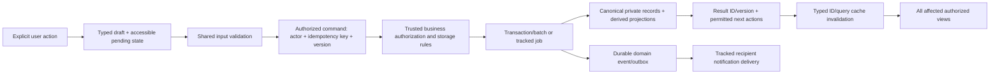

# Data source of truth and mapping

**Phase 1 — proposed product design, not implemented behavior.** Prepared 5 November 2026. Deliverables are confined to docs/master-product-blueprint/. The approved user-facing visual design is a constraint. Existing source, UI, Firebase schemas/rules/functions, dependencies and data are unchanged. “Target” describes the reviewed-to-be product contract; numeric, retention and rollout choices marked policy approval required are proposals, not existing promises.

## Logical target ownership

The following is a proposed logical data architecture. It does not add, rename or migrate any collection in this phase. Persisted paths and schema versions must be designed with compatible readers and an approved migration plan.

| Authority | Identity / important fields | Read scope | Source-of-truth rule |
| --- | --- | --- | --- |
| Private account | Auth UID; account status; provider references; private contact/security settings. | Owner and scoped staff/service only. | Canonical identity/moderation source; no raw public browse reads. |
| Intent/preferences | UID + version; activeIntents, active-search state, cities/areas/budget/lifestyle choices. | Owner; only specifically disclosed factors/results to others. | Directory projection and one versioned compatibility service; exact answers need explicit scope. |
| Public/member card | UID + projection/schema version; chosen display fields and eligibility evidence. | Public publisher subset or authorized member-directory scope. | Derived allowlist, never a spread of raw account fields. |
| Listing and published version | listingId; publisher UID; kind/unit/capacity, review and availability dimensions. | Owner draft private; effective public projection only when all gates pass. | Public detail/feed and owner/admin views use one canonical adapter/version. |
| Residence declaration | UID + listingId + version; explicit declaration/evidence reference. | Minimal public derived relation; source evidence scoped. | Separate from legal ownership and identity approval. |
| Inquiry/application | applicationId; applicant/listing/publisher IDs; answer snapshot and stage. | Applicant, listing steward and scoped staff only. | One record per meaningful listing interest/version policy; not consent status. |
| Pair consent and blocks | Canonical pair ID; participant UIDs; request/decision version; directional blocks. | Participants and scoped enforcement service. | Effective messaging authorization derived/rechecked; no client-created arbitrary mirrors. |
| Conversation/message/read state | conversationId/messageId/clientMessageId; participants; context references; own read cursor. | Authorized participant history; active accepted pair for sends. | Stable room identity, paged messages, per-member state; no tuple IDs. |
| Contact/address grant | Grant ID, data owner, permitted peer, purpose/fields/version. | Only owner and specifically granted peer/service. | Accepted connection alone never publishes private contact data. |
| Bookmarks | Owner UID + typed entity ID. | Self only. | One persistence contract from landing/cards/details/Saved. |
| Verification evidence/decision | Submission ID/version, subject UID, private object reference, consent, decision/reason/reviewer. | Subject status and reviewer capability; document never public. | Trust derived from exact reviewed evidence; no property auto-publication. |
| Notification/delivery | Event ID, recipient, typed target/version, delivery/read state. | Recipient and scoped delivery service. | Durable outbox/events avoid success claims based on a failed notification. |
| Moderation case | Case ID, typed target, reporter reference, scope, note, outcome and action job. | Reporter acknowledgement; capability-scoped staff evidence. | Resolution and required sanction must reach one consistent final result. |
| Outcome declaration | Outcome ID, declaring actor, context, confidence/source and correction version. | Private participant; consented aggregate only. | Independent of actual listing availability and legal tenancy. |
| Jobs and staff capabilities | Job/grant IDs, manifest/version, allowed operations, recipient snapshot and audit. | Owner job scope or explicit staff capability. | Track progress, partial failure, retry and actual completed results. |

## Command/read flow

## Service responsibility

Read projections may use Firebase directly when rules can enforce the full field/document scope. Membership, moderation propagation, sensitive cross-entity decisions, ID review/version checks, allowance accounting, recipient fanout and erasure need a trusted transaction/job contract. “Backend” denotes responsibility, not permission to add a new paid service. Existing SDK/Functions infrastructure may satisfy contracts once verified. Do not rely on hidden controls or client-supplied isAdmin/role fields.

The result includes command ID, entity ID/version, final or queued state, applicable retry/conflict information and a safe event reference. Known successful writes are not deleted because secondary notification delivery fails. An ambiguous timeout is reconciled by idempotency key before retrying. Multi-step Storage/Firestore work is not described as atomic; stage objects, commit references and clean abandoned state through tracked retention.

## Field semantics

Use typed money amounts/currency/unit; room share, full-property rent and per-bed price are not interchangeable. Preserve true zero deposit and computed zero match; absence is null/unknown rather than fabricated value. Dates have canonical timestamps/date/window types; display labels are derived, never persisted as “Today” or “Now” substitutes. Display names, legal/declared names, document types and review notes use explicit adapters. Account role labels do not grant publishing, residence or staff capability. Public/member projections are explicit allowlists, not raw account documents with four fields blanked in the UI.

## Query/index and compatibility plan

Define supported city/locality/kind/publication/availability/price-unit predicates and stable order before index design. Query key and cursor include normalized filter/ranking versions. Supporting host/owner/entity lookups are bounded and counted. Entity-by-ID reads authorize independently of the discovery query. Per-conversation history and staff lists are paginated. Aggregate counters/trends declare their scope and retain zero instead of synthetic growth.

Proposed contract changes require field-version readers, explicit old→new adapters and test fixtures for every supported legacy shape. Inventory actual legacy data read-only before proposing a backfill. No role/intent/opt-in/residence/status is auto-inferred or mass-activated. A migration is a separate reviewed operation with dry run, backup, idempotency, rollback and postconditions; this blueprint grants no migration authority.

## Input/output contract examples

| Operation | Input | Acknowledged output | Critical invariant |
| --- | --- | --- | --- |
| ReadEntity | Typed ID + viewer/session + optional authorized context | Projection + version + available actions OR scoped unavailable/error | No feed position or context query grants access. |
| SubmitInterest | Listing/version + answers + client command ID | Application ID + pair request state + usage result | No attributed application without listingId; no duplicate charge. |
| DecideConsent | Request/version + recipient decision | Accepted/closed current version + event ID | Only current recipient decision; block/withdraw conflict wins safely. |
| SendMessage | Room/clientMessageId + text/objectRef | Persisted message ID + room/read metadata version | Live authorization and idempotency at commit. |
| ReviewEvidence | Submission/version + reviewer decision/reason | Decision/version + derived trust job/commit | Exact inspected version; no Aadhaar/property claims. |
| ChangeAvailability | Listing/version + explicit capacity/status | Current availability/publication result | No fill from selection/consent. |
| RequestErasure | Self recent auth + confirmation + approved scope | Owner job ID/status/retention summary | No false complete status or accidental peer-history deletion. |

The actual implementation comparison follows the independently defined target model in the appendix below.

Implementation requires the separate review requested by the user. Current-source comparisons and evidence limitations are in EXISTING_APPLICATION_GAP_ANALYSIS.md; target acceptance criteria must not be counted as executed tests.

## Actual source mapping appendix — comparison after target design

This appendix describes inspected code, not the proposed storage layout. Logical records above can span services or collections; physical schema/index changes require review. No data or schema mutation was performed to make source match the target.

| Logical authority | Actual source / field evidence | Current divergence | Target handling |
| --- | --- | --- | --- |
| Auth/account identity | [app/src/hooks/useAuth.ts:1](../../app/src/hooks/useAuth.ts#L1); [app/src/lib/userIntent.ts:1](../../app/src/lib/userIntent.ts#L1) | Shared Auth UID and normalized housing intents exist. Role, resident/publisher identity and directory eligibility still need full cross-page enforcement. | Keep UID; independent intent/permission/residence/disclosure fields; reviewed legacy adapter. |
| Private account/contact | [app/src/lib/privateUserData.ts:1](../../app/src/lib/privateUserData.ts#L1); [app/firestore.rules:149](../../app/firestore.rules#L149) | Private user hydration exists, but users source remains publicly readable and member projections are not the active full browse contract (A29). | Audit actual field distribution before migration; public/member/private projections with enforceable read scopes. |
| Property money | [app/src/pages/AdminPage.tsx:242](../../app/src/pages/AdminPage.tsx#L242); [app/src/lib/nestmateBackend.ts:1](../../app/src/lib/nestmateBackend.ts#L1) | Admin reads rent and substitutes 14000; listing paths use monthlyRent/partnerShare/totalRent; prior six-record comparison observed 12000 becoming 14000 (A10). | Typed price amount/currency/unit with explicit adapter; never use display fallback as persisted truth. |
| Publication and availability | [app/src/pages/AdminPage.tsx:243](../../app/src/pages/AdminPage.tsx#L243); [app/src/lib/marketplaceVisibility.ts:32](../../app/src/lib/marketplaceVisibility.ts#L32) | Unrecognized draft/pending/rejected treated Active in admin; active and dormant eligibility differ (A11/A36). | Separate reviewed publication state/version and publisher-confirmed availability; one visibility contract. |
| Listing stewardship/residence | [app/firestore.rules:365](../../app/firestore.rules#L365); [app/src/lib/userIntent.ts:1](../../app/src/lib/userIntent.ts#L1) | ownerId is a record steward/publisher; cannot prove residence or legal ownership. | Keep stable publisher UID; explicit declared resident relationship; no inferred property title. |
| Bookmarks and entity IDs | [app/src/pages/ExplorePage.tsx:831](../../app/src/pages/ExplorePage.tsx#L831); [app/src/pages/ExplorePage.tsx:924](../../app/src/pages/ExplorePage.tsx#L924) | savedRoomIds/person IDs are mapped through loaded D/G/RM arrays (A20/A21). | Typed entity references plus authorized by-ID fetch/tombstone, independent of feed pagination. |
| Pair consent and application | [app/src/pages/ExplorePage.tsx:1887](../../app/src/pages/ExplorePage.tsx#L1887); [app/firestore.rules:405](../../app/firestore.rules#L405) | Rules/backend support optional listingId, but active sender calls targetUid only; applicant reader expects listing context (A49). | Separate pair identity/consent and application listingId/version/answer snapshot/stage. |
| Allowance period | [app/src/lib/nestmateBackend.ts:1235](../../app/src/lib/nestmateBackend.ts#L1235) | Cumulative free counter and absent Pro upsell; no demonstrated renewal model (A28). | Server period/usage/renewal contract only after D05 policy and legacy treatment approved. |
| Messages/read state | [app/src/lib/nestmateBackend.ts:780](../../app/src/lib/nestmateBackend.ts#L780); [app/src/lib/nestmateBackend.ts:790](../../app/src/lib/nestmateBackend.ts#L790) | Every day label Today, read unreadCount without complete durable send/read model (A08/A09). | Persist actual timestamps, idempotent message ID, per-member read cursor and atomic room summary. |
| Message/asset reference | [app/src/pages/ExplorePage.tsx:1255](../../app/src/pages/ExplorePage.tsx#L1255) | Raw FileReader data URL can become imageUrl; bypasses intended attachment Storage lifecycle (A07). | Validated owned object reference with upload/commit/retry/cleanup states, never base64 fallback. |
| Profile/preferences/avatar | [app/src/lib/profileEditor.ts:29](../../app/src/lib/profileEditor.ts#L29); [app/src/lib/nestmateBackend.ts:1674](../../app/src/lib/nestmateBackend.ts#L1674) | Single displayed area can replace multiple localities; selected avatar updates before form Save/Discard; matching defaults invent evidence (A25–A27/A46). | Versioned whole draft, preserve undisplayed values, staged avatar, unknown is explicit. |
| Manual identity evidence | [app/src/pages/AdminPage.tsx:306](../../app/src/pages/AdminPage.tsx#L306); [app/src/lib/nestmateBackend.ts:1825](../../app/src/lib/nestmateBackend.ts#L1825) | Submission documentType/declaredName/reviewNote disagrees with reader docType/legalName/rejectionReason; read-then-batch review is not version-preconditioned (A12/A32). | One private versioned evidence/review contract; exactly inspected version, manual-review meaning only. |
| Dormant identity mirror | [app/src/lib/ownerVerification.ts:206](../../app/src/lib/ownerVerification.ts#L206) | Dormant path sets Aadhaar true/level3 and auto-publishes; active manual review uses Aadhaar false/level2 (A50). | Reconcile/retire contradictory path after import/dependency review; no silent auto-publication. |
| Reports/moderation/staff | [app/src/pages/AdminPage.tsx:865](../../app/src/pages/AdminPage.tsx#L865); [app/firestore.rules:125](../../app/firestore.rules#L125) | Report can be resolved before sanction; wildcard admin check exceeds UI moderator distinctions (A17/A30). | Scoped capabilities, persisted selected outcome/note and tracked sanction/decision result. |
| Events/notifications/jobs | [app/src/pages/AdminPage.tsx:939](../../app/src/pages/AdminPage.tsx#L939); [app/src/pages/AdminPage.tsx:969](../../app/src/pages/AdminPage.tsx#L969) | Broadcast document/grant does not establish delivery/invitation; some catches report success (A14/A15). | Durable domain outbox with recipient events/job state; truthful membership-grant acknowledgement. |
| Export/deletion coverage | [app/functions/index.js:11](../../app/functions/index.js#L11); [app/functions/index.js:39](../../app/functions/index.js#L39) | Configured .appspot bucket differs from app .firebasestorage.app; reporterId/reportedBy and agreement paths need coverage; shared-room recursion affects peer history (A34/A35). | Approved D17 retention/peer policy, bucket manifest and resumable job; verified private export. |
| Environment and aggregates | [app/src/pages/AdminPage.tsx:692](../../app/src/pages/AdminPage.tsx#L692); [app/src/pages/AdminPage.tsx:1935](../../app/src/pages/AdminPage.tsx#L1935) | Zero-series can become synthetic positive data; Production badge hardcoded even in verified demo (A39/A52). | Real environment source and real zero/unknown counts; no fabricated telemetry. |

The active backend helper uses browser Firebase SDK calls; only requestAccountDeletion and getDiscoveryCompatibility are exported Cloud Functions in the inspected entry. Dormant hooks/projection helpers do not prove an active trusted command or sync service. Query indexes, outbox workers, scheduled expiry and retention/export services described in this blueprint are design requirements to implement or explicitly defer, not existing deployed guarantees.
