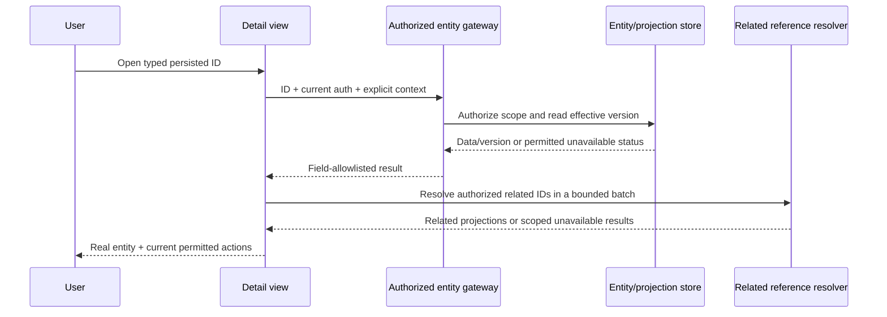

# Entity and detail-page relationships

**Phase 1 — proposed product design, not implemented behavior.** Prepared 5 November 2026. Deliverables are confined to docs/master-product-blueprint/. The approved user-facing visual design is a constraint. Existing source, UI, Firebase schemas/rules/functions, dependencies and data are unchanged. “Target” describes the reviewed-to-be product contract; numeric, retention and rollout choices marked policy approval required are proposals, not existing promises.

## Identity and authorization contract

Every entity read takes a typed persisted reference and returns one of: authorized data with version/scope; known inactive/unavailable projection where permitted; generic not-found/unauthorized response where existence is private; or retryable service error. The UI never resolves a valid detail from an array position or concludes deletion because the current feed lacks an item. Query parameters provide context, not permission. A public listing’s publisher is not automatically a resident or a legally verified property owner.

| Source → related entity | Authoritative IDs | Required data/permission | Navigation destination | Missing/inactive/deleted behavior |
| --- | --- | --- | --- | --- |
| Listing → publisher | listingId → publisherUid (current ownerId is record stewardship) | Published publisher display subset; authorized management scope for owner. | P09 contextual publisher view; no automatic resident/roommate label. | Missing/inactive publisher suppresses new public advertising; authorized history explains unavailable publisher. |
| Listing → resident host | listingId + residence declaration UID/version | Explicit residence and listing publication/availability evidence. | P09 resident profile linked back to the actual offered room. | No valid current available link → no have_room availability badge; preserve other valid intents. |
| Person → available place | UID → authorized associated listing IDs | Only published available related listings; verify stewardship/resident relation. | P08 by listingId, not a cached D index. | Unavailable listing removed from new host offer; contextual history retains honest status. |
| Saved → entity | ownerUid + entityType + entityId | Own bookmark plus independent authorized projection read. | P08/P09; neutral tombstone if access lost. | Never show inaccessible raw data; allow removing stale bookmark and retrying transient errors. |
| Application → listing/applicant | applicationId → listingId, applicantUid, publisherUid, listing version | Applicant/publisher/scoped staff; answer snapshot and separate stage. | P16 or applicant’s private status/context. | Listing inactive closes new submission; existing application retains policy-approved private status/history. |
| Pair request → people/context | requestId/version → two UIDs; optional context reference | Participants; introduction subset disclosed at request submission. | P11/P09/P08 after scope authorization. | No numeric coercion or disclosure from a forged context parameter; expired/deleted targets show generic unavailable. |
| Conversation → pair | conversationId → pair key and participants | Participant history scope; live consent/active accounts for sending. | P12; P09 header resolves counterpart UID. | Missing person does not become a fabricated profile or silently destroy all peer history. |
| Message → attachment | messageId → authorized objectRef/version | Room participant + valid object scope; send eligibility rechecked on commit. | Safe image viewer inside the existing approved chat flow. | Deleted/expired object is explicitly unavailable; history text and retry state remain coherent. |
| Verification → account/evidence | submissionId/version → subjectUid + private objectRef | Subject own status; reviewer explicit capability; no public evidence URL. | P19/P22; public trust receives only derived scoped status. | Missing evidence blocks a new approval; old reviewed version remains auditable under retention policy. |
| Notification → target | eventId → typed target ID and action/version | Recipient plus reauthorization of referenced target/action. | Exact entity/context, not a guessed first room or generic user index. | Stale action becomes a status explanation; opening does not replay a completed command. |
| Report → case target | caseId → typed listing/user/message ID + evidence scope | Reporter own acknowledgement; staff case capability; relevant private evidence only. | P22 typed inspector or safe acknowledgement. | Deleted content leaves policy-approved reference/tombstone, not a link to an unrelated listing. |
| Outcome → involved context | outcomeId → actor + optional listing/application/pair IDs | Private actor declaration; mutual statement requires both acknowledgements. | P20 own follow-up and explicit remaining-intent choice. | Outcome correction does not forge availability or rewrite peer declarations. |

## Detail loading sequence

## Place-detail completion

Show one canonical listing/version with actual facts, gallery, capacity/unit, costs, rules/questions, scoped trust and active/inactive status. Related publisher/resident actions resolve their own UIDs. Express interest passes the listing ID/version and questionnaire answers; an existing accepted pair skips another consent request but still creates the listing-specific inquiry record. Public anonymous users can inspect; protected actions open Auth with a safe return descriptor. Own unpublished detail is private, labelled preview and cannot be confused with the public version.

## Person-detail completion

Resolve a public-directory card, listing-publisher subset, pending-request introduction or accepted-relationship projection according to the viewer’s actual authorization. Show which context is being viewed. No private quiz/contact/ID evidence is read and then merely hidden with CSS. A person’s find_room/team_up/have_room semantics remain explicit. Match explanation includes missing evidence; deleted/restricted accounts cannot continue sending merely because an old profile page is cached.

Implementation requires the separate review requested by the user. Current-source comparisons and evidence limitations are in EXISTING_APPLICATION_GAP_ANALYSIS.md; target acceptance criteria must not be counted as executed tests.
