# Feature lifecycles and state diagrams

**Phase 1 — proposed product design, not implemented behavior.** Prepared 5 November 2026. Deliverables are confined to docs/master-product-blueprint/. The approved user-facing visual design is a constraint. Existing source, UI, Firebase schemas/rules/functions, dependencies and data are unchanged. “Target” describes the reviewed-to-be product contract; numeric, retention and rollout choices marked policy approval required are proposals, not existing promises.

## Reading the state model

The diagrams describe logical target states, not new persisted enums deployed in this phase. Each transition carries actor, expected version, reason/context, authorization and audit event. Server/service preconditions enforce the same contract as the UI. Account restriction and directional blocks override send/publication eligibility without rewriting historical facts. ID approval, content approval and availability remain orthogonal.

## Account moderation

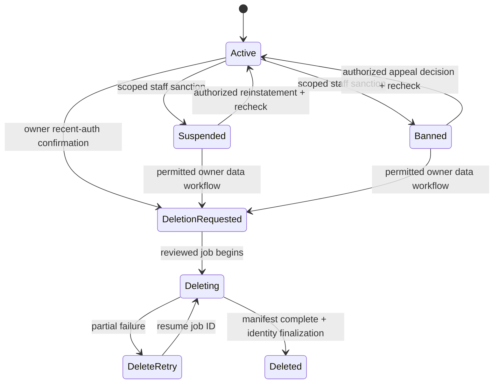

## Intent and directory publication

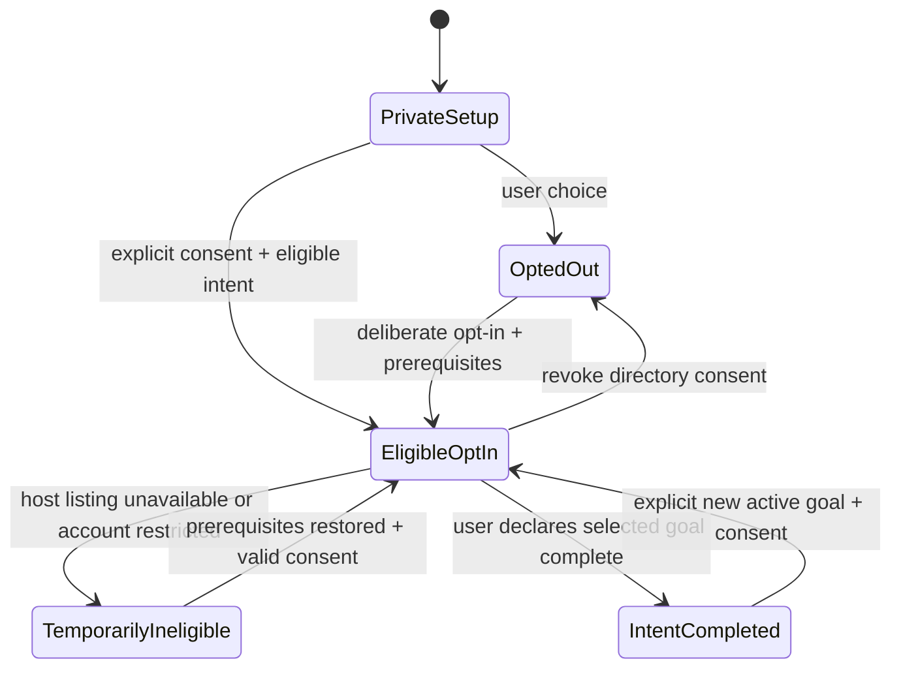

## Property publication

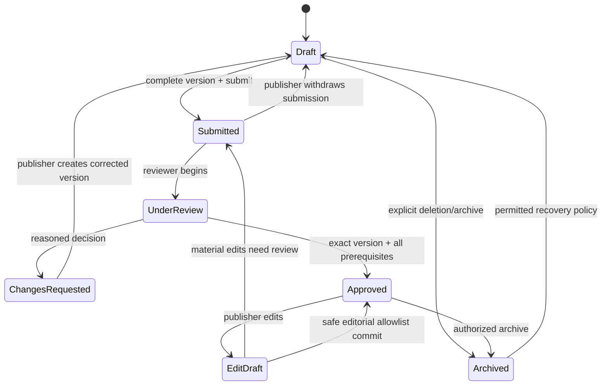

## Property availability (orthogonal to approval)

```mermaid
stateDiagram-v2
  [*] --> Unavailable
  Unavailable --> Available: approved + authorized + active + declared capacity
  Available --> Paused: publisher pause
  Available --> Filled: explicit publisher confirmation
  Available --> Expired: configured reconfirmation policy
  Available --> Restricted: publisher/account or content restriction
  Paused --> Available: explicit resume + prerequisites
  Filled --> Available: explicit reopen + capacity + prerequisites
  Expired --> Available: explicit reconfirm + prerequisites
  Restricted --> Paused: restriction removed; re-evaluate before resume
```

## Pair communication consent

```mermaid
stateDiagram-v2
  [*] --> None
  None --> Pending: eligible sender + recipient-open + allowance
  Pending --> Accepted: recipient accepts current version
  Pending --> Declined: recipient declines
  Pending --> Withdrawn: sender withdraws
  Pending --> Expired: configured visible expiry
  Accepted --> Revoked: participant revokes or blocking policy
  Declined --> None: recipient explicitly reopens or initiates
  Withdrawn --> None: allowed new explicit request
  Expired --> None: allowed new explicit request
  Revoked --> None: restrictions cleared; never auto-accept
```

## Application/consideration

```mermaid
stateDiagram-v2
  [*] --> Submitted
  Submitted --> InReview: publisher begins
  InReview --> Shortlisted: publisher consideration
  Submitted --> Declined: publisher decision
  InReview --> Declined: publisher decision
  Shortlisted --> Declined: publisher decision
  Shortlisted --> Selected: publisher selects intent to proceed
  Selected --> MutuallyAcknowledged: applicant also acknowledges
  Submitted --> Withdrawn: applicant withdraws
  Shortlisted --> Withdrawn: applicant withdraws
  Selected --> Withdrawn: applicant declines continuation
  Submitted --> ListingUnavailable: listing closes
  Shortlisted --> ListingUnavailable: listing closes
  MutuallyAcknowledged --> Closed: explicit follow-up; no automatic occupancy
```

## Identity evidence and review

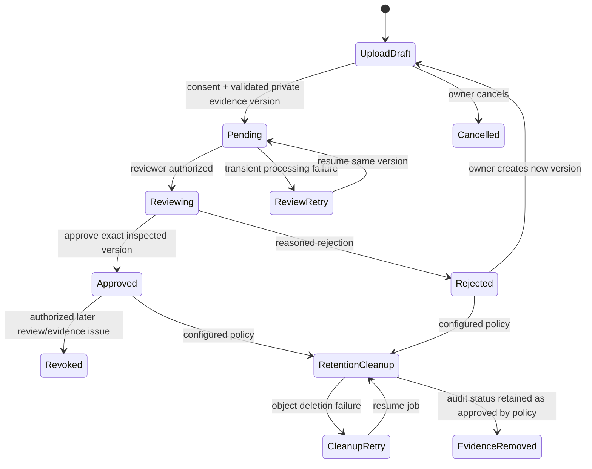

## Message/attachment delivery

```mermaid
stateDiagram-v2
  [*] --> LocalDraft
  LocalDraft --> Uploading: image chosen + authorization
  Uploading --> LocalDraft: cancel/failure; keep prior draft
  Uploading --> ReadyToCommit: validated object reference
  LocalDraft --> Sending: text + idempotency key
  ReadyToCommit --> Sending: current send eligibility
  Sending --> Failed: offline/denied/timeout confirmed failure
  Failed --> Sending: same client ID retry
  Sending --> Acknowledged: durable message commit
  Acknowledged --> Read: recipient cursor advances
  Acknowledged --> UnavailableAttachment: retained text; object access removed
```

## Housing outcome declaration

```mermaid
stateDiagram-v2
  [*] --> Searching
  Searching --> TeamUpProposed: private declaration
  TeamUpProposed --> TeamUpAcknowledged: both acknowledge
  Searching --> HousingFound: self-report labelled
  TeamUpAcknowledged --> HousingFound: later declared result
  HousingFound --> MovedInDeclared: optional self-report
  HousingFound --> Searching: correct/reopen chosen intent
  MovedInDeclared --> Searching: explicit new need
  TeamUpProposed --> Searching: withdraw/correct
  TeamUpAcknowledged --> Searching: explicit change; no lease/booking inference
```

## Jobs: export/deletion/broadcast/propagation

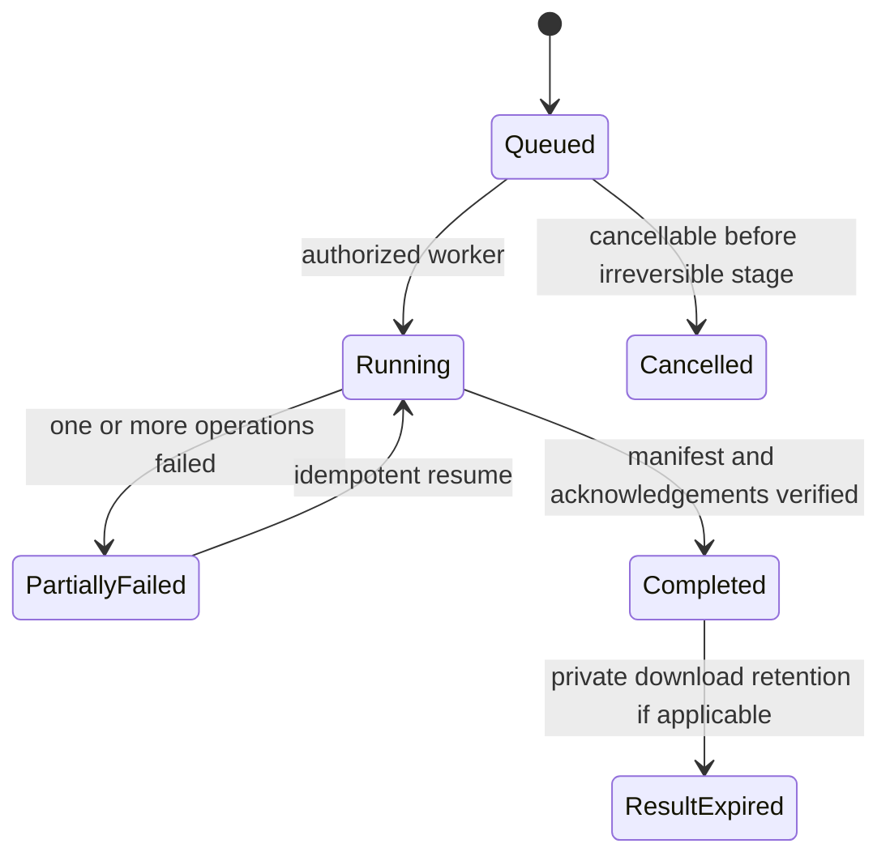

## Bookmark resolution

```mermaid
stateDiagram-v2
  [*] --> Unsaved
  Unsaved --> Saving: explicit signed-in action
  Saving --> Saved: acknowledged typed entity reference
  Saving --> Unsaved: failure or cancel before commit
  Saved --> Unavailable: entity deleted or no longer authorized
  Unavailable --> Saved: reauthorized entity becomes available
  Saved --> Removing: owner removes save
  Unavailable --> Removing: owner removes reference
  Removing --> Unsaved: acknowledged removal
  Removing --> Saved: failed removal; reconcile original reference
```

## Recipient notification

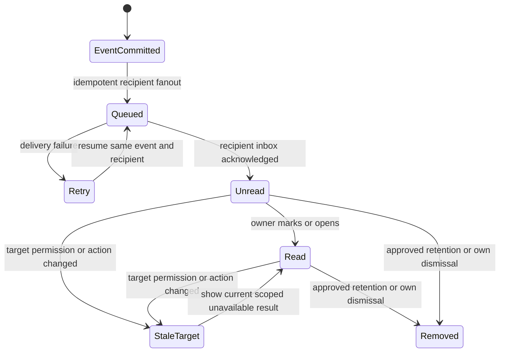

## Moderation and support case

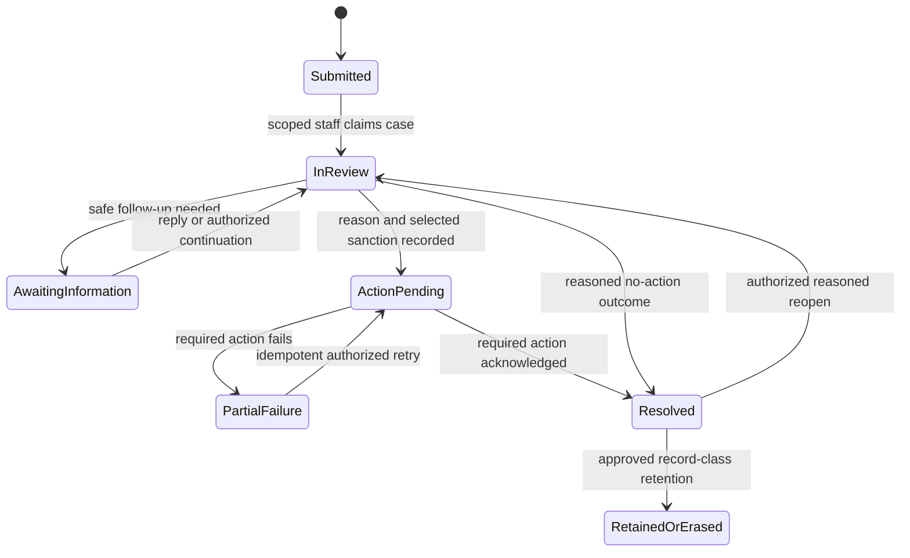

## Private contact or address grant

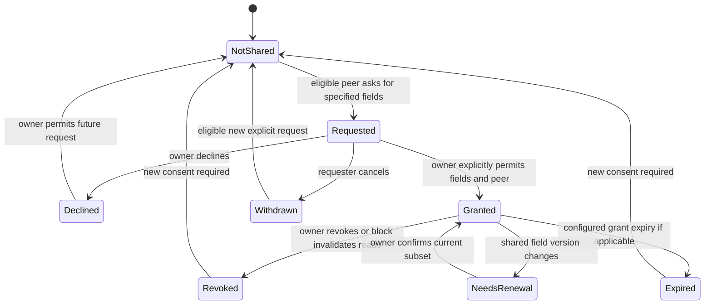

## Cross-state invariants

1. Public place = current approved version AND declared available capacity AND active authorized publisher AND configured freshness/trust prerequisites.
2. Human have_room badge additionally needs explicit valid residence/listing linkage; another valid team_up intent survives a filled room.
3. Send = current accepted pair AND active eligible participants AND no active directional block. History access has its own reviewed scope.
4. Selected applicant, mutual acknowledgement, accepted request and ID approval never automatically create occupancy, fill capacity or publish property.
5. A failed notification is delivery work, not reversal of a committed domain event.
6. Retry reuses the same command/job/client ID and checks expected version; it does not charge twice or approve unseen content.
7. Unblock cannot remove another person’s block or restore accepted access automatically.
8. Expiry/retention are explicit policy timestamps with user-visible meaning; unknown timestamps are not “Now” or “Today.”

## Relevant deletion/recovery

Draft deletion can remove its staging objects after a safe retry window; deleting a property from public discovery does not silently erase all private reports or peer conversations. Account erasure follows D17 record-class policy and tracked jobs. A member may reverse a self-reported outcome without rewriting another person’s declaration. Staff reopens a case through a reasoned decision; immutable audit events are not rewritten as if no decision occurred.

Implementation requires the separate review requested by the user. Current-source comparisons and evidence limitations are in EXISTING_APPLICATION_GAP_ANALYSIS.md; target acceptance criteria must not be counted as executed tests.
