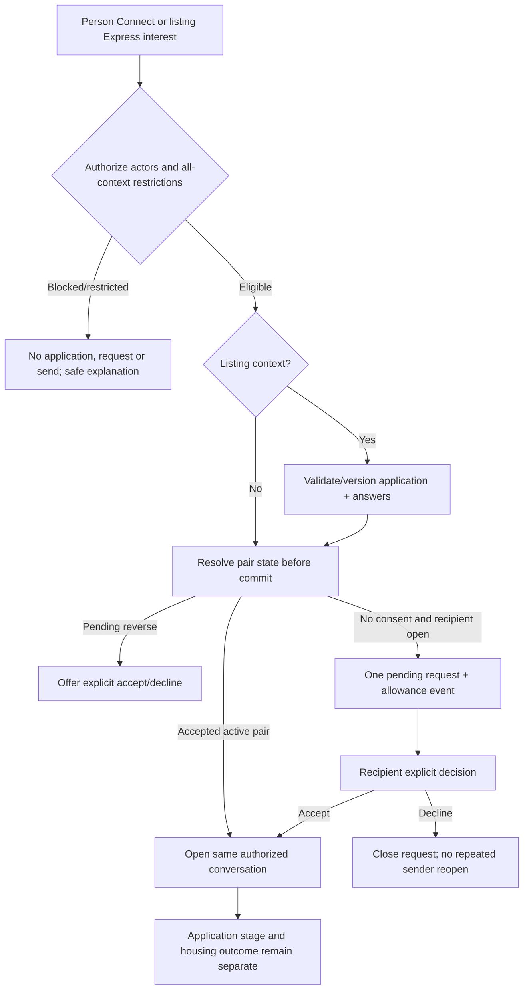

# Interaction and communication model

**Phase 1 — proposed product design, not implemented behavior.** Prepared 5 November 2026. Deliverables are confined to docs/master-product-blueprint/. The approved user-facing visual design is a constraint. Existing source, UI, Firebase schemas/rules/functions, dependencies and data are unchanged. “Target” describes the reviewed-to-be product contract; numeric, retention and rollout choices marked policy approval required are proposals, not existing promises.

## One coherent interaction model

A person-only request asks for permission to communicate. A listing inquiry expresses interest in one property and may supply screening answers. If the pair has no consent, that inquiry creates/attaches one pending pair request in the same idempotent operation; it does not force the applicant through two equivalent approval gates. If consent is already accepted, the inquiry can open the existing conversation with a new listing context. The publisher still controls the application stage separately.

## Action matrix

| Action | Eligibility / transition | Other user sees | Failure/cancellation / next |
| --- | --- | --- | --- |
| Connect | Active complete sender; authorized target; no block; allowance; none→pending. | Minimal disclosed introduction and context; accept/decline. | Duplicate idempotent; reverse pending becomes Incoming; sender can withdraw. |
| Express interest | Available listing + valid required answers; create application; create consent only if needed. | Listing/version/answers, consideration stage and separate communication request. | Listing changed → refresh answers/context; no new charge for an existing accepted pair. |
| Accept/decline | Recipient of current pending version only. | Accepted Message or closed generic decline; private reason stays private. | Conflicting withdrawal/block returns actual state, not local success. |
| Withdraw | Own pending request/inquiry, with explicit entity scope. | Closed scope without erasing an unrelated accepted relationship. | No blanket quota refund; show current accepted state on conflict. |
| Message | Accepted active pair; current send authorization. | Persisted message with per-recipient delivery/read state. | Failed draft remains retryable by clientMessageId; no phantom conversation/message. |
| Contact/address sharing | Data owner explicitly approves a specific disclosure to that peer. | Only the granted subset; public source remains private. | Revocation affects future reads; cannot promise recall of copied data. |
| Block | Either person owns their directional block; overrides all pair contexts. | Generic restriction; no disclosure of blocker/reason or a block notification. | Idempotent server state; existing/new-room sends and attachments denied. |
| Unblock | Only owner removes their block. | No automatic notification/accepted access; remaining peer block stays effective. | Fresh explicit consent required if all restrictions removed. |
| Applicant shortlist/select | Publisher of specific listing/application. | Truthful consideration update where policy permits; no implied tenant contract. | No automatic communication acceptance, fill or occupancy. |

## Permission is evaluated at commit

Buttons derive from the same authoritative pair/application/account versions across cards, person detail, listing detail, Connections, Notifications and chat. The service rechecks active accounts, blocks, pending ownership and current consent on every sensitive commit. Private profile access and historical chat access are narrower/scoped reads; suspension/block denies new sends even in already-open rooms. Exact anonymous response and history-retention policy must avoid account-existence leaks and undocumented loss.

## Notifications and quotas

Durable domain events/outbox entries derive recipient notifications after the business commit. Delivery is tracked independently; failure to send a notification must not erase a committed request or charge twice. Notification opening reauthorizes the typed target; stale actions show current state. Only a new eligible outbound pair request consumes the approved allowance, atomically with its request ID/period. Existing accepted communication, retries, duplicate/reverse pending requests and opening a chat do not. The D05 numeric/renewal proposal requires policy approval and a reviewed legacy conversion.

## Deliberately excluded mechanics

No automatic contact disclosure, unsolicited listing-owner chat exception, automatic filling from acceptance/selection, arbitrary resending after decline, “typing” or “email sent” claims without an implemented signal, or payment/booking confirmation is included. Optional typing/read-receipt disclosure can be added only with an enforceable privacy setting; the core send/read model does not depend on it.

Implementation requires the separate review requested by the user. Current-source comparisons and evidence limitations are in EXISTING_APPLICATION_GAP_ANALYSIS.md; target acceptance criteria must not be counted as executed tests.
