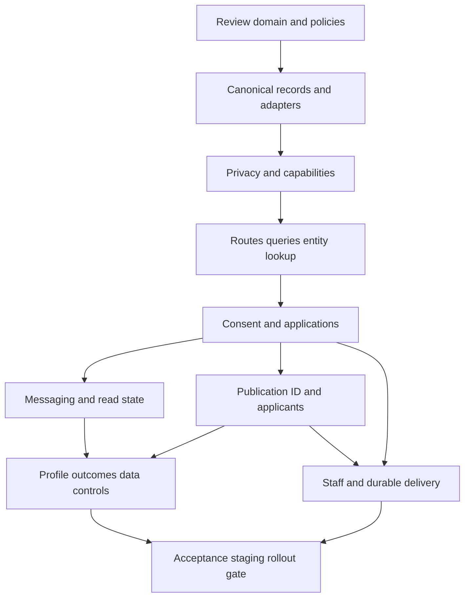

# Master implementation roadmap

> Current implementation: the later workflow-correction brief authorized application changes after this > Verified continuation, 8 November 2026: private export jobs, durable broadcast retries, live chat draft preservation, saved discovery/broadcast settings, and real support-ticket submission are implemented locally. Current evidence: 474 source tests, 22 Functions tests, 72 rules assertions, 19 backend groups, and 12 final browser checks. Full product acceptance and production rollout remain open; see the current acceptance report above.

Phase 1 proposal. See [current acceptance and remaining work](../workflow-correction/ACCEPTANCE_STATUS.md). The original blueprint and its historical approval boundary below are preserved; deployment and production migrations remain separate.

Phase 1 • Product blueprint and source comparison • 5 November 2026

## Approval boundary

This is a dependency-aware implementation proposal, not authorization to change the app or deploy. The next phase begins only after blueprint review and a separately approved scope. P0 indicates foundational or release-blocking work, not evidence of a production incident; P1 indicates the core journey. Calendar estimates require team/capacity review and are intentionally not fabricated. Each package should become a small reviewable change with tests appropriate to the contract, rather than a page-by-page rewrite.

## Dependency graph

R02/R03 contracts precede consumer repair. Implementation may be staged by coherent vertical slice with safe compatibility, but cannot bypass negative access tests. Data-control work may remain gated/deferred without blocking an explicitly scoped browse/request release; it must not keep a fake functional UI. Optional D22 features are outside these core packages until justified.

| Package / priority | Outcome | Depends on | Contract coverage | Affected areas / data | Work and rationale | Acceptance / review gate |
| --- | --- | --- | --- | --- | --- | --- |
| R01 P0 · review before build | Approve domain and policy contracts | None | All P/T; D01–D22 | Blueprint only; assign product/trust/privacy owners and record choices. | Resolve D05/D09/D14/D17/D19 and optional scope or explicitly defer dependent features. Agree entity/permission/state terminology. | Reviewed decision register and prioritized rollout scope; no deployment/migration authorization implied. |
| R02 P0 · foundational | Canonical records, units and field adapters | R01 | P04–P22; T02 T06 T23 T25 T26 | nestmateBackend.ts, userIntent.ts, profileEditor.ts, AdminPage.tsx, Functions; Firestore types/index design. | Define UID/listing/application/pair/room IDs; canonical rent units/status/ID fields, missingness and versioning. Read legacy via explicit adapter. Create migration inventory/dry-run separately. | Same seeded record renders identical actual price, unit, status, declared name/type/note on detail, dashboard and staff; unknown remains unknown. |
| R03 P0 · privacy/access boundary | Projections, capability enforcement and restrictions | R01 R02 | D03 D07 D08 D15 D16 D18; T16 T20 T26 T30 T31 T32 | firestore.rules, storage.rules, privateUserData.ts, projection writer, active backend commands; staff membership. | Public physical projection and opted-in member cards; owner/contact/evidence access matrix; scoped staff checks; either-direction blocks and active-account enforcement. Plan staged compatibility before denying old clients. | Independent principals cannot read private source/evidence/grant staff; existing open rooms cannot send/upload after restriction; rightful self-data access remains defined. Negative emulator/Storage tests must pass. |
| R04 P1 · navigation/discovery | Durable route and authorized entity/query service | R02 R03 | P01–P13 P21; T01 T02 T03 T05 | App.tsx, LandingPage/landing controls, ExplorePage.tsx, useStore.ts, nestmateBackend.ts; Firestore query/index definitions. | Canonical filter URL, supported predicates before pagination, stable loaders/tombstones, typed Saved; preserve back/scroll and current design. Content routes and sitemap match actual destinations. | Hero city/budget/category/move-in survives navigation/reload. Saved/shared/chat/notification entity outside first page resolves correctly. No fake featured inventory or success toast before clipboard completes. |
| R05 P1 · consent and applications | Pair consent plus listing inquiry and allowance | R01 R02 R03 R04 | P08 P09 P11 P13 P16; T06–T10 T23 | ExplorePage.tsx, nestmateBackend.ts, request/application schema/rules/indexes; domain event/outbox service. | Atomic deduplicated pair/period usage plus listing application answer/version snapshot; reverse/declined/withdraw/expiry/restricted states; separate applicant stage and real-time listeners. | Two-session/retry tests prove exactly one quota charge and intended recipient decision. Existing accepted pair adds listing context without new consent. Shortlist/select never fills property. |
| R06 P1 · communication | Reliable messages, read state and attachments | R03 R04 R05 | P12 P13; T11–T16 | ExplorePage.tsx chat, nestmateBackend.ts, Storage/message rules, room/member read schema and indexes. | Deterministic pair room, clientMessageId, paged actual dates, atomic summary, per-member read cursor, validated attachment upload/orphan recovery, explicit contact share scope. | Text/attachment retry yields one message; reload preserves unread state for each person. Wrong UID never opens another profile. Failed upload never sends base64 fallback; either block stops new sends. |
| R07 P1 · inventory/trust | Versioned publication, availability, ID and applicant operations | R01 R02 R03 R04 R05 | P14–P19 P22; T18–T23 T26 | Listing wizard/detail/dashboard, AdminPage.tsx, ID backend/Storage, lifecycle rules and query eligibility. | Reviewed content/publication separate from availability; exact-version manual ID; material edit policy; applicant comparison uses actual known factors. Dormant contradictory ownerVerification path must be retired or reconciled through approved dependency review. | Draft/pending/rejected never displays Active by fallback. ID review does not auto-publish. Concurrent changed submission cannot receive stale approval. Only explicit publisher confirmation fills capacity; actual applicant updates propagate. |
| R08 P1 · account completion | Profile drafts, outcomes and working data controls | R01 R02 R03 R04 R06 R07 | P03 P18–P21; T04 T24–T29 | profileEditor.ts, useAuth.ts, Explore profile, private profile/consent/outcome records; Functions/export/deletion jobs. | Stage avatar with Save; preserve locality list; enforceable privacy/unblock; optional private outcomes; provider-aware credentials. Export/deletion remain gated on D17 coverage/policy and service availability. | Discard changes no saved profile/photo. Outcome changes only chosen intents; owner availability independent. Export is a private working download; deletion tracks manifest/retries and verified bucket/path coverage with peer-history policy. |
| R09 P1 · operations truth | Staff decisions, durable delivery and truthful aggregates | R02 R03 R05 R07 | P13 P22; T17 T20 T26 T30–T32 | AdminPage.tsx, moderation backends, trusted jobs/notification outbox, environment/config adapters. | Track sanction application before final resolution; audited explicit staff grants; fan-out job status; real counts with zero/unknown; actual environment. Remove false reset/purge/invitation success controls. | Forced sanction/delivery failure remains pending/partial and retries idempotently. Moderator cannot perform admin/ID-only work. No manufactured positive counts or delivered/invited toast without actual action. |
| R10 P0 release gate · after dependent packages | Acceptance, compatibility staging and controlled rollout | R04 R05 R06 R07 R08 R09 | All P/T and cross-page/failure maps | Source test imports, current route E2E, rules/Storage/Functions tests, CI deploy gates, README/QA metadata; no production fixture reset. | Repair current broken test imports and stale routes; add meaningful contract/security and independent-session acceptance tests. Stage reviewed adapters/projections/indexes before stricter reads, reconcile evidence/counts, review migration separately, then limited rollout/monitoring/rollback. | All approved T/P acceptance and negative access gates pass on isolated fixtures; route refresh/back/mobile and screen-reader labels validated. Build/test/rules gates required by deployment. Reconcile no unexpected PII exposure, lost bookmarks/requests or mixed-version publication before any live release. |

## Test and review traceability

| Gate | Required evidence | Acceptance reference |
| --- | --- | --- |
| Domain review | Approve/defer policies and record unresolved owners; confirm no booking/payment/ownership assumptions. | D01–D22; vision/capability matrices. |
| Read and projection safety | Anonymous, incomplete member, opted-in person, sender, recipient, blocked/restricted, publisher, moderator, reviewer and administrator principals; direct forbidden reads/writes as well as hidden UI. | P04–P09 P12 P19 P22; T02 T11 T13 T16 T20 T26 T30–T32. |
| Transactional workflows | Duplicate, reverse, stale-version, lost response, simultaneous decisions, expiry and secondary delivery failure; inspect DB/Storage outcomes in both sessions. | T05–T23 T26 T29–T32; failure recovery scenarios. |
| Navigation/query correctness | Each current and approved target route refreshed directly; deep link outside first page; back/forward/filter/scroll restoration; search supported query scope before pagination. | T01–T05 T11 T14; information architecture/entity relationships. |
| Cross-page consistency | Use the same canonical IDs across discovery/Saved/detail/profile/requests/messages/applicants/staff; reconcile exact status/units/read state after reload. | All 15 cross-page event contracts; A06 A08 A10–A12 A18–A22 A49. |
| Completion/privacy | Save/discard, block/unblock, ID reject/resubmit, private outcome, export/deletion job retry and partial failure with approved retention fixture policy. | T16 T24–T29; D17/D18/D20. |
| Presentation/accessibility | Preserve current visual design; verify actual loaded views at existing 390/768/1440 widths, keyboard/focus/error labels and unique IDs. Screenshots alone cannot pass functional gates. | D21; P01–P22 acceptance; A45. |
| Release readiness | Repair the historical missing imports and stale E2E destinations; run appropriate build/lint/unit/Functions/rules/Storage/independent-user suites. Capture exact command/version/environment/results; wire mandatory gates before deploy. | A41–A44; R10. Historical results in the gap analysis are not a new pass. |

## Compatibility and operational rollout

Before any migration, inventory field distributions, orphan IDs, storage buckets/prefixes, legacy request counters and currently published records using an approved read-only process. Design an explicit version adapter and dry-run reconciliation with backup/rollback. Do not migrate on login, guess owner residence, convert permanent counters into a new monthly period, or apply new trust policy to all existing listings automatically.

Deploying projections/indexes, updating readers and restricting legacy source access must be sequenced so old clients do not require temporary broad access. Security fixes that cannot tolerate a compatibility window need a reviewed service/feature restriction. A rollback must not restore a known unsafe read/write rule. Preserve stable IDs and record an auditable reconciliation of counts, statuses, consent and assets.

Operational monitoring should report real domain/notification job lag, conflicting versions, entity-loader misses, request duplicates/quota errors, upload/orphan failures, moderation backlog and deletion/export retry outcomes. Define thresholds and accountable responders during implementation planning; no current telemetry or on-call service is assumed.

## Next reviewable implementation slice

Recommended first approved slice: R01 policy/domain review followed by R02's rent/status/ID field adapters plus R04's landing-to-discovery typed query contract, with R03 access prerequisites where necessary. These address demonstrated cross-page contradictions while preserving the interface. Do not start a complete replatform or the optional map/reviews/push/translation backlog. Choose a bounded package after review; implementation and deployment permissions remain separate.

