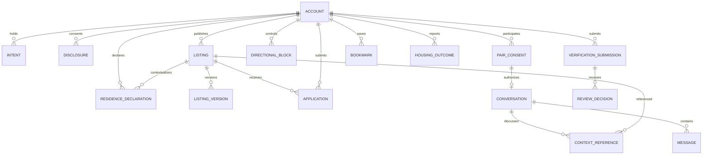

# Product vision and domain model

**Phase 1 — proposed product design, not implemented behavior.** Prepared 5 November 2026. Deliverables are confined to docs/master-product-blueprint/. The approved user-facing visual design is a constraint. Existing source, UI, Firebase schemas/rules/functions, dependencies and data are unchanged. “Target” describes the reviewed-to-be product contract; numeric, retention and rollout choices marked policy approval required are proposals, not existing promises.

## Product promise and completion

NestMate helps a person find a suitable long-term place, suitable people to live with, or a suitable applicant for an actual available place. Its unit of value is a qualified housing conversation that leads to an informed, consensual offline housing decision, followed by an honest availability/search update. A browsing session, accepted request or successful message is an intermediate milestone; none proves a move-in. The product must reduce irrelevant discovery, unclear identity, unsolicited contact and stale inventory without making users surrender unnecessary personal data.

## Distinct domain concepts

| Concept | Meaning | Never infer from |
| --- | --- | --- |
| Account identity | One Auth UID and its private membership/moderation state. | A public display name, a role selector or a listing array index. |
| Housing intent | Current find_room, team_up and/or have_room needs. | Permanent seeker/owner labels or another completed intent. |
| Publisher/steward | Account authorized to manage the advertisement and applicant context. | Legal title to real estate. Current ownerId is a record-ownership field. |
| Resident host | A person explicitly declaring residence at the associated available home. | Being an owner, a manager, identity-verified or accepted in chat. |
| Accommodation | Physical room, shared space, entire flat or managed room/bed offer. | A person profile, vague role or estimated price. |
| Communication consent | Pair-level permission to start/continue messages. | Shortlisting, comparing, sending an inquiry or selecting a potential tenant. |
| Application/inquiry | A person’s expression of interest and answers for one listing/version. | All relationships with that publisher or a binding housing agreement. |
| Identity review | Staff decision about specified private identity evidence. | Government authentication, ownership, residence, property inspection or guaranteed safety. |
| Publication approval | Authorization to display a reviewed property version. | Identity approval alone. |
| Availability | Publisher’s current declaration of advertised capacity. | An accepted connection, a shortlisted/selected applicant or someone’s private outcome. |
| Housing outcome | Self-reported or mutually acknowledged team-up/housing progress. | Booking, lease signature, payment, tenancy proof or automatic occupancy. |

## Canonical relationship map

These are logical relationships and proposed ownership boundaries, not changes to Firestore collections. Compatibility adapters may retain current document paths during a separately approved implementation.

## Non-goals and constraints

No hotel nights, reservations, deposits/payments collected by NestMate, mandatory OTP, paid KYC provider, contract-signing workflow or group-management product is assumed. No promise of comprehensive fuzzy text search or globally ranked personalized matches without an implemented query/ranking service. Preserve the approved visuals; improve behavior and information meaning. Core onboarding should be progressive, not a fixed long questionnaire blocking anonymous property browsing.

## Definition of a completed journey

Room seeker: inspect real property → send qualified interest → receive consent → discuss/visit independently → declare housing found or continue searching. Team-up seeker: inspect a compatible consenting person → accepted conversation → mutual team-up acknowledgement → search accommodation together → optional housing declaration. Resident host: publish an actual spare room → review listing-specific applicants → communicate consensually → select/confirm offline arrangement → explicitly update capacity/filled status. Commercial publisher: publish physical inventory and handle qualified inquiries without appearing as a roommate. Staff: apply a justified, auditable case decision whose effects actually reach member/public views.

## Measurable success, with honest evidence

Measure query-to-qualified-detail, attributed-interest-to-accepted-consent, acknowledged-send delivery, publisher response, supported outcome declarations and inventory reconfirmation. Define denominator/cohort and retain null when no data exists. No synthetic growth charts, fabricated testimonials or presumed move-ins. Collect only necessary event IDs/context, not message text, contact details or ID documents in analytics.

Implementation requires the separate review requested by the user. Current-source comparisons and evidence limitations are in EXISTING_APPLICATION_GAP_ANALYSIS.md; target acceptance criteria must not be counted as executed tests.
